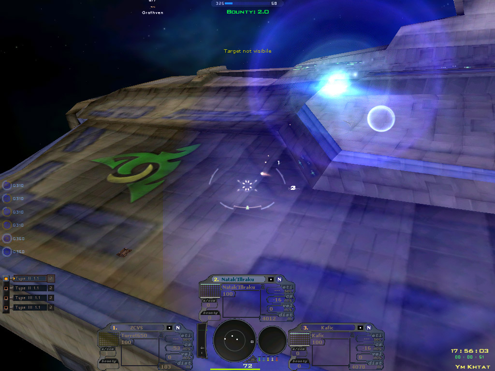
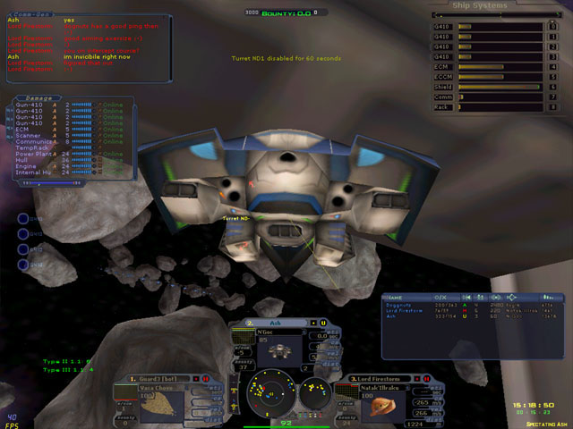
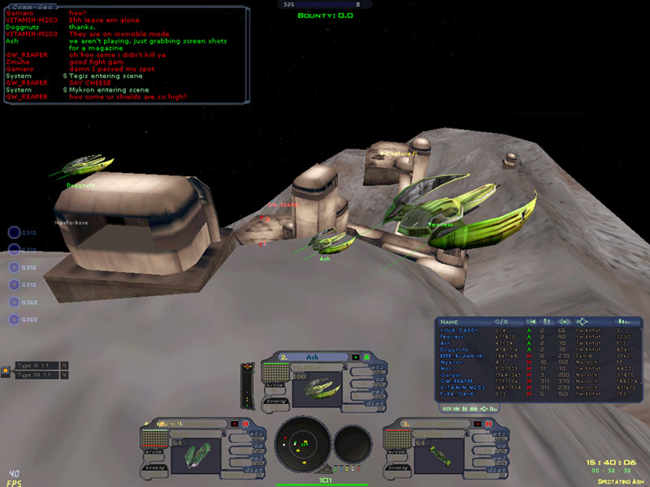
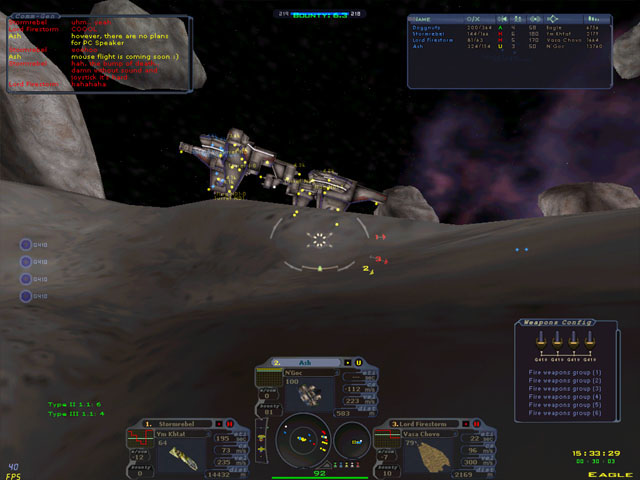
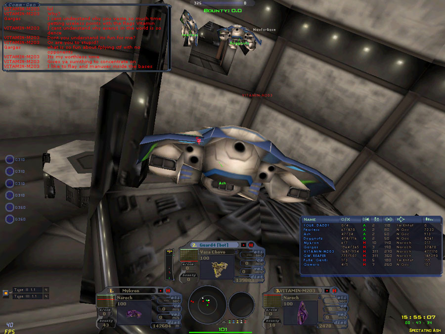
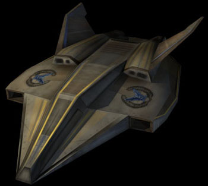
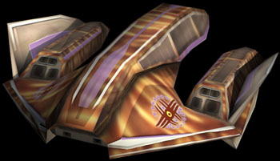
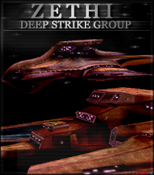
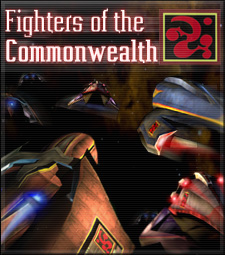

  

<h1 align="center">Ace of Angels (2002 space combat game): preservation project</h1>

  <em>Recovering, documenting and playing again</em> Ace of Angels, <em>the online 3D
  space combat sim by Flying Rock Enterprises of Marietta, Georgia, winner of
  Technical Excellence at the 2002 Independent Games Festival.</em>

  
  
  
  
  

  <a href="docs/play/README.md"><b>Play it</b></a> ·
  <a href="docs/host/README.md"><b>Host a game</b></a> ·
  <a href="docs/host/linux.md"><b>Linux server</b></a> ·
  <a href="CONTEXT.md"><b>Research record</b></a> ·
  <a href="docs/README.md"><b>Docs</b></a> ·
  <a href="CONTRIBUTING.md"><b>Contribute</b></a>

  
   
  In flight, from the screenshot gallery on the official site, aceofangels.com.

> [!NOTE]
> This is *Ace of Angels*, the 2002 PC space combat sim by Flying Rock
> Enterprises, not the K-pop group AOA ("Ace of Angels"). Searching? Pair the
> name with "Flying Rock" or "space".

## 🚀 The game

*Ace of Angels* was an online space-fighter game built by a small team in
Marietta, Georgia, "since 1996". Set in the early 26th century in the
**Known Sphere** (8 races, 10 nations), it promised 40+ fighters, capital
ships and persistent faction politics. It won **Technical Excellence at the
2002 Independent Games Festival**, shipped free betas on magazine cover discs
in 2002–2004, and was scheduled for release in March 2006. It never launched.
Its servers went dark, and the company was dissolved in 2011.

<table>
  <tr>
    <td width="50%"></td>
    <td width="50%"></td>
  </tr>
  <tr>
    <td width="50%"></td>
    <td width="50%"></td>
  </tr>
</table>

  
  
  
  
   
  The Shrike and Grathven fighters, and two "Spotlight" features from the universe pages.

## 🛰️ What this project has

| | |
|---|---|
| 📦 **Builds** | Six client versions recovered, hashed and versioned: full installers 2.0.0, 2.7.1, 2.8.0, 2.8.2 and 2.9.2, plus a 2.3.1 replacement client. Sources and hashes: [`manifest/downloads.json`](manifest/downloads.json). |
| 🎮 **Playable today** | The 2.9.2 client runs on Windows 11 with crash, timing and display fixes, and the offline training mission plays. |
| 🌐 **Multiplayer** | A new stand-in server, written from reverse engineering, lets friends dogfight over a LAN (a private VPN is implemented but untested): guns, missiles, kills, scoreboard, ship changes, power-ups and a host window. The client can load all 20 recovered map layouts; 11 of them have real content ([which maps](docs/STATUS.md#maps)). |
| 🐧 **Dedicated Linux host** | An unattended systemd service with automatic map rotation, kill/time limits, admission recycling, a stalled-process watchdog and rotation state that survives reboot. [Setup and operation](docs/host/linux.md). |
| 📜 **History** | Magazine coverage, company records, trademarks, the old website and forums (restored from the Wayback Machine), and the state of revival attempts. |

No game files are in this repository. The tools download the original
installer from public archives into your own folder and modify only your copy.
See [NOTICE.md](NOTICE.md).

### Honest status

> [!IMPORTANT]
>
> - **Two separate Windows PCs have fought through the Linux host over LAN.**
>   A Windows-hosted LAN game and VPN play between separate connections have
>   not been recorded yet.
> - Players must quit, relaunch and rejoin between maps.
> - This is a trusted-friends relay, not a public server. There are no accounts,
>   and the original clients decide hits and damage.
> - No CTF rules, AI missions or persistent pilots yet. Practice target ships
>   can be destroyed, but they are passive and never fire back.
>
> What was checked, how, and what is still untested: [docs/STATUS.md](docs/STATUS.md).

## 🧭 Start here

| I am… | Start with | Then |
|---|---|---|
| A player on Windows | [docs/play/README.md](docs/play/README.md) | [Troubleshooting](docs/play/troubleshooting.md), [sharper skins](docs/play/texture-pack.md), [any map](docs/play/map-viewer.md) |
| Hosting for friends | [docs/host/README.md](docs/host/README.md) | [Host window](docs/host/host-window.md), [Linux service](docs/host/linux.md), [console](docs/host/console.md) |
| Making maps, objects or video | [docs/create/custom-maps.md](docs/create/custom-maps.md) | [Objects](docs/create/custom-objects.md), [highlight reel](docs/create/hype-reel.md) |
| Contributing code or reverse engineering | [CONTRIBUTING.md](CONTRIBUTING.md) | [References](docs/README.md#contributors), [tools](docs/reference/tools.md), [findings](docs/research/findings.md) |
| Researching the history or hunting builds | [CONTEXT.md](CONTEXT.md) | [Research records](docs/README.md#researchers), [leads wanted](CONTRIBUTING.md#leads-and-old-material) |

What works and what is untested: [docs/STATUS.md](docs/STATUS.md). Every
document, by reader: [docs/README.md](docs/README.md).

## ⚡ Quick start

On Windows 11:

1. Install [Python](https://www.python.org/downloads/) 3.10 or later, with
   **Add python.exe to PATH** ticked. No packages are needed.
2. Download this project (**Code → Download ZIP**) and extract it.
3. Double-click `Play.cmd` and follow its setup checklist: it downloads the
   2.9.2 installer from archive.org (35 MB, after asking), unpacks it,
   applies the fixes and helps you add the graphics wrapper.

To host, double-click `Host.cmd` ([hosting](docs/host/README.md)). Details and
the command-line fallback: [docs/play/README.md](docs/play/README.md). The
windows were rebuilt on 16 November 2026 and have not yet been run on Windows
([status](docs/STATUS.md#implemented-but-not-tested)).

## 🗂️ Repository layout

| Path | Contents |
|---|---|
| `Play.cmd`, `Host.cmd` | The player and host windows |
| [`aoa/`](aoa/) | The code, as one Python package: file formats, protocol, maps, client patches, the host, the launchers, research and analysis |
| [`tools/`](tools/README.md) | The commands people run, mostly shims for `aoa` modules; [every command](docs/reference/tools.md) |
| [`tests/`](tests/) | Every test suite, run by `tools/test.py` ([how](CONTRIBUTING.md#tests)) |
| [`archive/`](archive/README.md) | Frozen one-off scripts whose results are committed under `evidence/` |
| [`docs/`](docs/README.md) | Guides, references, research records and roadmaps, indexed by reader |
| [`deploy/linux/`](deploy/linux/) | Linux systemd service and example host/rotation configuration |
| [`CONTEXT.md`](CONTEXT.md) | The archive research record: builds, sources, what was searched, next steps |
| `manifest/` | Where each recovered build came from, with hashes |
| `evidence/` | Machine-readable results behind each claim in the docs ([index](evidence/INDEX.tsv)) |
| `data/` | Archive search logs, magazine mentions, the 20 October research handoff |
| `config/` | Client configuration records |
| [`CLAUDE.md`](CLAUDE.md) | Working rules for coding agents |

`builds/`, `game/`, `originals/`, `wb/`, `work/` and `media/` are created
locally and never committed.

## 🤝 Contributing

Bug reports from real play sessions, old discs and screenshots, and protocol
findings are all welcome. See [CONTRIBUTING.md](CONTRIBUTING.md).

## ⚖️ Licence

The code and documentation here are MIT-licensed ([LICENSE](LICENSE)).
*Ace of Angels* itself belongs to its owners; this project is unofficial and
unaffiliated ([NOTICE.md](NOTICE.md)).

  
   
  Images on this page come from the archived official sites, aceofangels.com and
  flyingrockllc.com (2000–2007), recovered from the Wayback Machine. They belong to
  their owners; sources are in <a href="docs/images/SOURCES.md">docs/images/SOURCES.md</a>.

