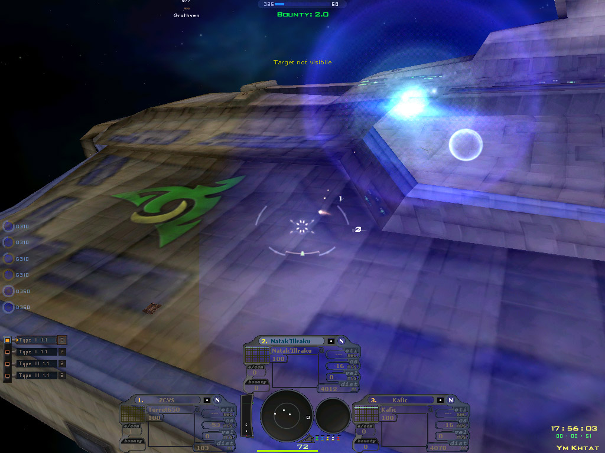
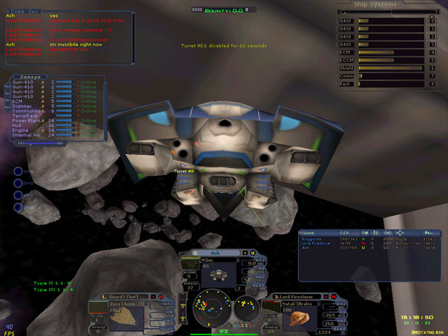
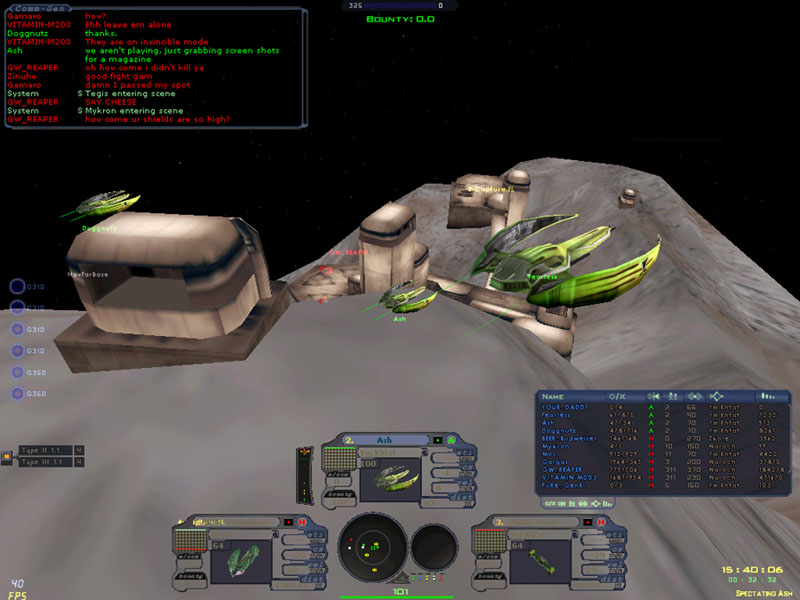
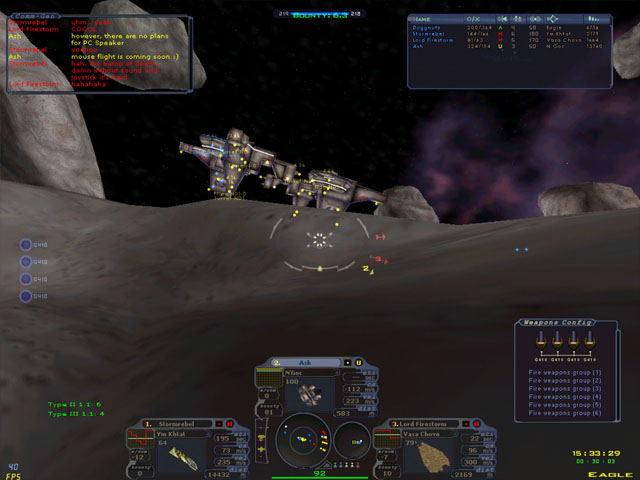
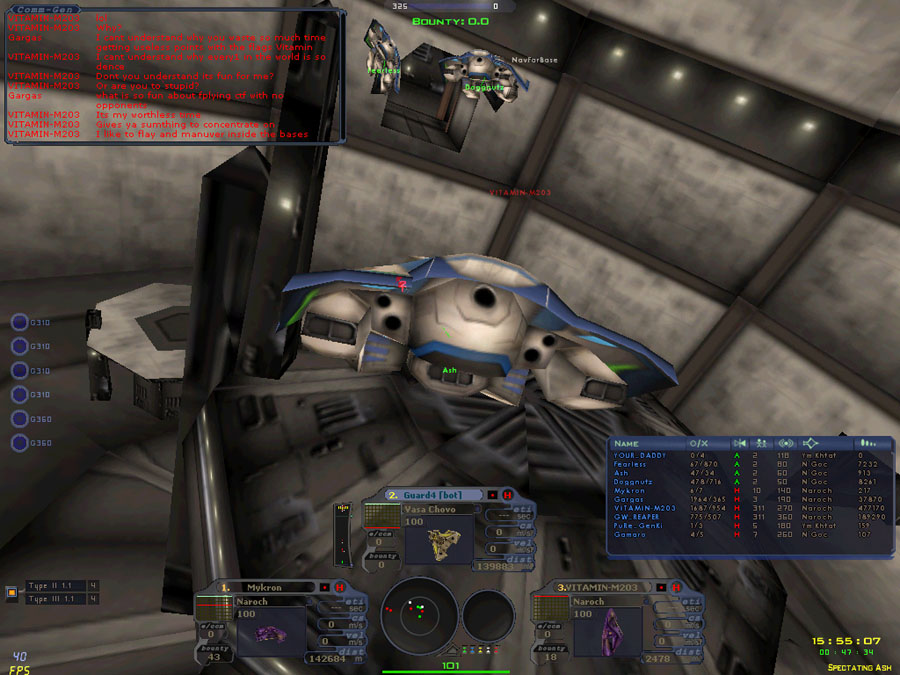
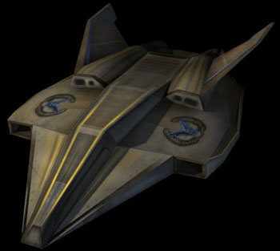
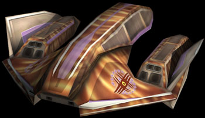
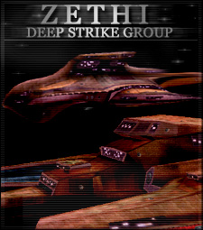
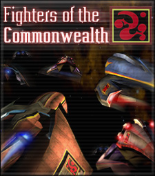

<p align="center">
  
</p>

<h1 align="center">Ace of Angels preservation project</h1>

<p align="center">
  <em>Recovering, documenting and playing again</em> Ace of Angels, <em>the online 3D
  space-combat sim by Flying Rock Enterprises (2000–2006).</em>
</p>

<p align="center">
  
  
  
  
  <a href="LICENSE"></a>
</p>

<p align="center">
  <a href="docs/play.md"><b>Play it</b></a> ·
  <a href="docs/play.md#play-with-friends"><b>Host a game</b></a> ·
  <a href="CONTEXT.md"><b>Research record</b></a> ·
  <a href="docs/README.md"><b>Docs</b></a> ·
  <a href="CONTRIBUTING.md"><b>Contribute</b></a>
</p>

<p align="center">
  
  <br>
  <sub>In flight, from the screenshot gallery on the official site, aceofangels.com.</sub>
</p>

> [!NOTE]
> Not to be confused with the K-pop group AOA ("Ace of Angels"). Searching?
> Pair the name with "Flying Rock" or "space".

## 🚀 The game

*Ace of Angels* was an online space-fighter game built by a small team in
Marietta, Georgia, "since 1996". Set in the early 26th century in the
**Known Sphere** (8 races, 10 nations), it promised 40+ fighters, capital
ships and persistent faction politics. It won **Technical Excellence at the
2002 Independent Games Festival**, shipped free betas on magazine cover discs
in 2002–2004, and was scheduled for release in March 2006. It never launched.
Its servers went dark, and the company was dissolved in 2011.

<table>
  <tr>
    <td width="50%"></td>
    <td width="50%"></td>
  </tr>
  <tr>
    <td width="50%"></td>
    <td width="50%"></td>
  </tr>
</table>

<p align="center">
  
  
  
  
  <br>
  <sub>The Shrike and Grathven fighters, and two "Spotlight" features from the universe pages.</sub>
</p>

## 🛰️ What this project has

| | |
|---|---|
| 📦 **Builds** | Six client versions recovered, hashed and versioned: full installers 2.0.0, 2.7.1, 2.8.0, 2.8.2 and 2.9.2, plus a 2.3.1 replacement client. Sources and hashes: [`manifest/downloads.json`](manifest/downloads.json). |
| 🎮 **Playable today** | The 2.9.2 client runs on Windows 10/11 with crash, timing and display fixes. The offline training mission plays. |
| 🌐 **Multiplayer** | A new stand-in server, written from reverse engineering, lets friends dogfight over a LAN or a private VPN: guns, missiles, kills, scoreboard, ship changes, 20 maps, power-ups and a host control window. |
| 📜 **History** | Magazine coverage, company records, trademarks, the old website and forums (restored from the Wayback Machine), and the state of revival attempts. |

No game files are in this repository. The tools download the original
installer from public archives into your own folder and modify only your copy.
See [NOTICE.md](NOTICE.md).

### Honest status

> [!IMPORTANT]
> - Multiplayer is tested with real clients on one PC and with simulated players.
>   **A session between separate PCs has not been recorded yet.** If you try one,
>   please [report how it went](../../issues).
> - This is a trusted-friends relay, not a public server. There are no accounts,
>   and the original clients decide hits and damage.
> - No CTF rules, AI missions or persistent pilots yet. Practice target ships
>   can be destroyed, but they are passive and never fire back.

## 🧭 Start here

| I want to… | Go to |
|---|---|
| Play it on Windows 10/11 | [docs/play.md](docs/play.md) |
| Host a game for friends | [docs/play.md#play-with-friends](docs/play.md#play-with-friends) |
| Read the history and what was found | [CONTEXT.md](CONTEXT.md), then [docs/](docs/README.md) |
| Help reverse-engineer the client or server protocol | [docs/README.md](docs/README.md#how-the-game-works) and [docs/findings.md](docs/findings.md) |
| Help find missing builds or old material | [CONTRIBUTING.md](CONTRIBUTING.md#leads-and-old-material) |

## ⚡ Quick start

On Windows 10/11 with [Python 3.12](https://www.python.org/downloads/) and Git:

```powershell
git clone https://github.com/JasonRucinski/ace-of-angels-preservation.git ace-of-angels
cd ace-of-angels
py -3.12 -m venv .venv
.venv\Scripts\python.exe -m pip install -r requirements.txt
.venv\Scripts\python.exe -I tools\fetch_known_builds.py builds\
```

Then download the [dgVoodoo2 2.87.5 wrapper](https://github.com/dege-diosg/dgVoodoo2/releases/download/v2.87.5/dgVoodoo2_87_5.zip)
and follow [docs/play.md](docs/play.md) from step 3.

## 🗂️ Repository layout

| Path | Contents |
|---|---|
| [`docs/`](docs/README.md) | Guides, research write-ups, protocol notes and roadmaps, with an index |
| [`tools/`](tools/README.md) | Player scripts, the stand-in server, client patches, analysis tools and tests, with an index |
| [`CONTEXT.md`](CONTEXT.md) | The research record: builds, sources, what was searched, next steps |
| `manifest/` | Where each recovered build came from, with hashes |
| `evidence/` | Machine-readable results behind each claim in the docs |
| `data/` | Archive search logs and magazine mentions |
| `config/` | Client configuration records |
| `CLAUDE.md` | Working rules for AI coding agents (and a good summary for humans) |

`builds/`, `game/`, `originals/`, `wb/` and `work/` are created locally and
never committed.

## 🤝 Contributing

Bug reports from real play sessions, old discs and screenshots, and protocol
findings are all welcome. See [CONTRIBUTING.md](CONTRIBUTING.md).

## ⚖️ Licence

The code and documentation here are MIT-licensed ([LICENSE](LICENSE)).
*Ace of Angels* itself belongs to its owners; this project is unofficial and
unaffiliated ([NOTICE.md](NOTICE.md)).

<p align="center">
  
  <br>
  <sub>Images on this page come from the archived official sites, aceofangels.com and
  flyingrockllc.com (2000–2007), recovered from the Wayback Machine. They belong to
  their owners; sources are in <a href="docs/images/SOURCES.md">docs/images/SOURCES.md</a>.</sub>
</p>
